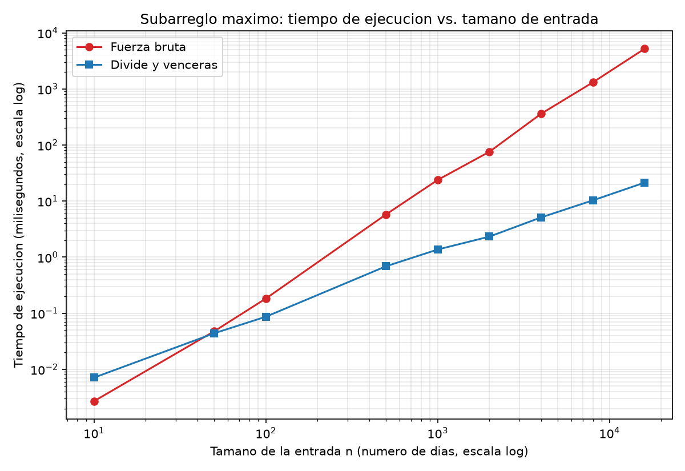

# Laboratorio 2 — Subarreglo máximo: fuerza bruta vs. divide y vencerás


### Situación problema
Una cooperativa registra la variación diaria de su caja (positiva o negativa) y quiere saber cuál es la racha de días consecutivos con la mayor suma total. El laboratorio resuelve este problema de dos formas, fuerza bruta (Θ(n²)) y divide y vencerás (Θ(n log n)), y compara su tiempo de ejecución al crecer la cantidad de datos para recomendar la más adecuada.

## Estructura

```
curso-analisis-algoritmos/
└── lab2-divide-y-vencer/
    ├── README.md
    ├── subarreglo.py
    ├── pruebas.py
    ├── medicion.py
    └── graficas/
        └── tiempo_vs_n.png
```


# Desarrollo

## Parte 1: Implementación

Código en [`subarreglo.py`](subarreglo.py): `subarreglo_fuerza_bruta` (Θ(n²), suma acumulada), `suma_cruzada` y `subarreglo_maximo` (divide y vencerás, resuelve los casos izquierdo, derecho y cruzado sin llamar a la fuerza bruta). Pruebas en [`pruebas.py`](pruebas.py): serie de ocho días (suma 17), un elemento, todos negativos, todos positivos, tramo que cruza el punto medio, 50 listas aleatorias enteras y 20 de flotantes, comparando siempre la suma.

## Parte 2: Medición

Código en [`medicion.py`](medicion.py). Se cronometra solo la llamada al algoritmo con `time.perf_counter()`, con la misma lista para ambos algoritmos, y el propio experimento verifica que las sumas coinciden en cada tamaño.

| n | Fuerza bruta (ms) | Divide y vencerás (ms) |
|---:|---:|---:|
| 10 | 0,0026 | 0,0064 |
| 50 | 0,0418 | 0,0388 |
| 100 | 0,1467 | 0,0825 |
| 500 | 5,684 | 0,563 |
| 1000 | 22,09 | 1,175 |
| 2000 | 89,12 | 2,620 |
| 4000 | 368,7 | 5,311 |
| 8000 | 1629 | 11,09 |
| 16000 | 6802 | 22,98 |




## Parte 3: Análisis

**1. Recurrencia.** 

`subarreglo_maximo` parte el rango en dos mitades y hace **dos llamadas recursivas**, cada una sobre **n/2** días (a = 2, b = 2). Luego `suma_cruzada` barre desde el punto medio hacia la izquierda y hacia la derecha: entre los dos barridos recorre cada elemento del rango una vez, así que cuesta **Θ(n)**. Comparar los tres candidatos son dos comparaciones, Θ(1), y el caso base (un día) también es Θ(1). Por tanto:

T(n) = 2·T(n/2) + Θ(n)

Método maestro: n^(log_b a) = n^(log₂ 2) = n. Como f(n) = Θ(n) = Θ(n^(log_b a)), aplica el **caso 2** (con k = 0: f(n) = Θ(n^(log_b a) · log⁰ n)). Resultado: **T(n) = Θ(n log n)**.

La fuerza bruta fija i (n valores) y para cada uno recorre j desde i hasta n−1. Como la suma se acumula, cada iteración interna cuesta Θ(1). Total de iteraciones: n + (n−1) + … + 1 = n(n+1)/2 = **Θ(n²)**.

**2. Medido contra esperado.** 

Con ambos ejes en escala log, la curva de fuerza bruta (roja) sube con pendiente cercana a 2 (de 22 ms en n = 1000 a 6802 ms en n = 16000), mientras la de divide y vencerás (azul) sube con pendiente cercana a 1 (de 1,2 ms a 23 ms). Al duplicar n de 4000 a 8000, la fuerza bruta pasa de 368,7 a 1629 ms (×4,42) y divide y vencerás de 5,31 a 11,09 ms (×2,09). De 8000 a 16000: ×4,18 y ×2,07. Θ(n²) predice ×4 y Θ(n log n) predice 2·log(2n)/log(n) ≈ ×2,17 en n = 4000. Coincide: la fuerza bruta queda ~5 % por encima de 4 y divide y vencerás ligeramente por debajo de 2,17 (ruido de medición y caché), pero claramente cerca de 2 y no de 4.

**3. Tamaños pequeños.**

Sí hay cruce en mi rango. En n = 10 la fuerza bruta gana (0,0026 vs 0,0064 ms); en n = 50 están empatadas (0,042 vs 0,039 ms); en n = 100 divide y vencerás ya gana (0,083 vs 0,147 ms, ~1,8 veces) y la ventaja crece: ~10 veces en n = 500 y ~300 veces en n = 16000. El cruce está alrededor de **n ≈ 50**. La notación asintótica oculta constantes: divide y vencerás hace ~2n llamadas recursivas, crea tuplas y compara en cada una, mientras el ciclo interno de la fuerza bruta es muy simple. Con n pequeño, n(n+1)/2 y n log n son parecidos (55 vs 33 en n = 10), así que esas constantes deciden.

**4. ¿Cuándo conviene dividir?**

Para el máximo de un arreglo, dividir en mitades y combinar con una comparación da T(n) = 2T(n/2) + Θ(1). Con n^(log₂ 2) = n y f(n) = Θ(1) = O(n^(1−ε)), es el caso 1: **Θ(n)**. Recorrerlo una vez también es Θ(n), con n−1 comparaciones, igual que dividir. Entonces no mejora, y solo añade llamadas recursivas. En el subarreglo máximo sí conviene porque la alternativa era Θ(n²): al partir, los subproblemas cuestan 2·(n/2)² = n²/2 y combinar cuesta solo Θ(n), mucho menos que lo ahorrado. Dividir conviene cuando combinar cuesta poco frente a lo que se ahorra; en el máximo ya no hay nada que ahorrar.

**5. Concepto para la gerente.**

Recomiendo **divide y vencerás**. Estimación (no medición) a partir de n = 16000, donde la fuerza bruta tardó 6,8 s y divide y vencerás 0,023 s. Con 1.000.000 de registros n crece 62,5 veces. La fuerza bruta crece como n², así que se multiplica por 62,5² ≈ 3906: ≈ 26.600 s, unas **7 a 8 horas**. Divide y vencerás crece como n log n: se multiplica por (10⁶·log₂10⁶)/(16000·log₂16000) ≈ 89, o sea ≈ **2 segundos**. Una regla de tres lineal daría ~7 minutos para la fuerza bruta, subestimando el tiempo real unas 60 veces, porque ignora que el tiempo crece al cuadrado. Es una extrapolación desde tamaños de hasta 16.000 y en mi equipo; con 10⁶ datos el efecto de la memoria caché podría cambiar los valores.


## Cómo reproducir

```bash
python pruebas.py    # ejecuta los assert; imprime "Todas las pruebas pasaron."
python medicion.py   # imprime la tabla y regenera graficas/tiempo_vs_n.png
```

