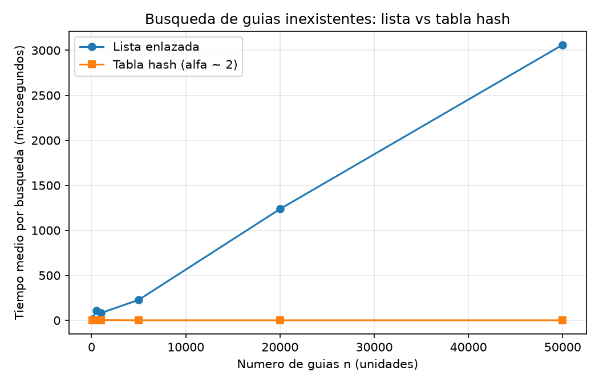
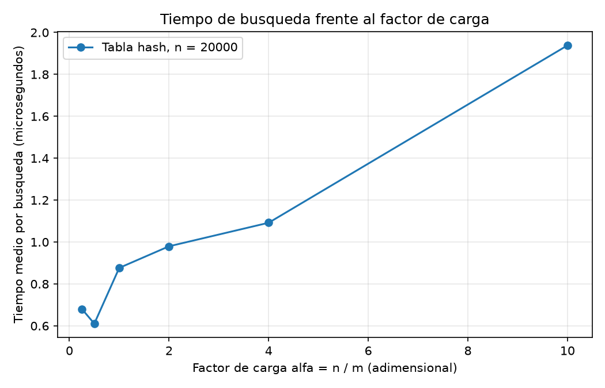

# Laboratorio 3 — Estructuras de datos: Rutas del Caribe

## Mis datos:
- **Nombre** Andres Mauricio Agudelo Elorza
- **Grupo** 190304006-3

## Cómo reproducir

```bash
# desde la raíz del repositorio

# activar el entorno virtual (Linux / macOS)
source venv/bin/activate

# activar el entorno virtual (Windows)
venv\Scripts\activate

cd lab3-estructuras-datos

# ejecutar las pruebas
python pruebas.py

# ejecutar los experimentos y regenerar las gráficas
python medicion.py      
```


## Parte 1 — Implementación y verificación 

Código: [estructuras.py](estructuras.py) - [pruebas.py](pruebas.py)

Implementé `ListaEnlazada` (inserción al inicio en Θ(1), búsqueda iterativa con `while`) y `TablaHash` con encadenamiento, donde cada casilla es una `ListaEnlazada` y la función hash es `h(k) = k mod m`. No se usan `dict`, `set` ni `hash()`.

`pruebas.py` verifica con `assert`:

- Búsqueda exitosa e infructuosa en la lista y en la tabla.
- Colisión forzada con m = 7: las guías 10, 24 y 17 caen en la casilla 3, se insertan y se recuperan, y la lista de esa casilla tiene longitud 3.
- `factor_carga()` devuelve 3/7 tras esas tres inserciones.
- Veinte colecciones aleatorias (semillas 0 a 19, con tamaños y valores de m distintos) en las que lista y tabla devuelven lo mismo, tanto para guías existentes como inexistentes.

## Parte 2 — Mediciones

Código: [medicion.py](medicion.py)





**Cómo medí.** En ambos experimentos busqué 200 guías inexistentes (generadas con semilla fija) y calculé el tiempo medio por búsqueda con `time.perf_counter()`, cronometrando solo las búsquedas. Las guías existentes se generan con semilla fija y son las mismas para ambas estructuras. Antes de medir, el propio experimento verifica que lista y tabla devuelven el mismo estado para una muestra de 100 guías existentes.

- Experimento A: n = 100, 500, 1000, 5000, 20000 y 50000, con m primo cercano a n/2 (m = 47, 251, 499, 2503, 10007 y 24989), de modo que α ≈ 2.
- Experimento B: n = 20000 y m = 79999, 40009, 19997, 10007, 4999 y 1999, que dan α ≈ 0,25; 0,5; 1; 2; 4 y 10.

## Parte 3 — Análisis

### 1. Costo teórico

Para una guía que no existe, la lista tiene que comparar contra los `n` nodos antes de concluir que no está: `Θ(n)`.

En la tabla calculo `h(k) = k mod m` en tiempo constante y recorro solo la cadena de esa casilla, que en promedio mide `n/m = α`. Como la guía no existe, la recorro completa. El costo es `Θ(1 + α)`: el 1 es el hash y α es la cadena.

Esto se sostiene con el supuesto de hash uniforme simple: cada guía cae en cualquiera de las `m` casillas con igual probabilidad e independencia. Si todas cayeran en la misma casilla, esa cadena tendría `n` nodos y buscar costaría `Θ(n)`: la tabla se volvería una lista enlazada.

### 2. Lo medido contra lo esperado

En la gráfica 1, entre `n = 20.000` y `n = 50.000` la lista pasa de unos 1.240 µs a unos 3.060 µs. `n` se multiplicó por 2,5 y el tiempo por 2,47. Coincide con `Θ(n)`.

La tabla se ve plana pegada al cero. En mi salida de consola pasó de 0,56 a 0,65 µs, un factor de 1,15 frente a 2,5 de `n`. Eso es casi `Θ(1)`; el leve aumento lo atribuyo a la caché.

En la gráfica 2, el tiempo va de unos 0,6–0,7 µs con α = 0,25 y 0,5 a unos 0,9 µs con α = 1, 1,0 µs con α = 2, 1,1 µs con α = 4 y 1,9 µs con α = 10. A partir de α = 1 sube casi linealmente, unos 0,1 µs por unidad de α sobre una base cercana a 0,8 µs. Es una constante más un término en α, coherente con `Θ(1 + α)`. Los dos primeros puntos bajan un poco, y lo atribuyo a ruido.

### 3. Las colisiones

Una colisión ocurre cuando dos claves distintas dan la misma casilla. Pasa aunque haya más casillas que guías porque el hash reparte como al azar y es muy probable que alguna pareja coincida, como en el problema del cumpleaños. Evitarlas del todo exigiría una función perfecta.

Ejemplo con `m = 7`: 10, 24 y 17 dan 3 al aplicar mod 7, así que las tres compiten por la casilla 3.

- **Encadenamiento:** las tres quedan en la lista de la casilla 3. Ventaja: es simple, borrar es fácil y admite α > 1. Costo: memoria extra por nodos y punteros, y poca localidad en caché.
- **Direccionamiento abierto:** si la casilla 3 está ocupada, pruebo la 4, la 5, etc., hasta hallar una libre. Ventaja: no usa punteros y es compacto. Costo: exige α < 1, se degrada al llenarse, forma agrupamientos y borrar es complicado.

### 4. Tabla hash o árbol de búsqueda

Para "guías entre X y Y" la tabla no sirve: el hash dispersa las claves, así que guías cercanas en valor quedan en casillas sin relación y tendría que revisar las `n`: `Θ(n)`.

Un árbol de búsqueda binario mantiene las claves ordenadas: bajo hasta el primer valor del rango y recorro en orden hasta Y, en `O(h + k)` con `k` guías devueltas.

Si las 400.000 guías llegan ordenadas y se insertan una a una, cada una va a la derecha de la anterior. El árbol queda como una lista de altura ≈ 400.000. Insertar todo cuesta unas `n²/2 ≈ 8×10¹⁰` comparaciones y cada búsqueda cerca de 400.000. Un árbol equilibrado tiene altura `⌊log₂ 400.000⌋ ≈ 18`, así que cada búsqueda cuesta unas 19 comparaciones y el rango `~19 + k`.

### 5. Concepto para la jefa de operaciones

Recomiendo una tabla hash para la consulta puntual y un árbol equilibrado (AVL o rojo-negro) para los rangos, ambos con las mismas guías. La tabla responde "¿estado de la guía X?" en tiempo casi constante y el árbol "guías entre X y Y" en `O(log n + k)`. El costo es el doble de memoria y mantener ambas al día en cada inserción.

**Estimación** (no medición) para 5.000.000 de envíos, guía inexistente:

- **Lista:** la gráfica 1 muestra una recta, así que la forma es lineal y puedo extrapolar. La pendiente es unos 3.060 µs / 50.000 ≈ 0,06 µs por nodo. Con 5×10⁶ nodos: ≈ 300.000 µs, **unos 0,3 s**. Probablemente sea más, porque con millones de nodos dispersos fallará más la caché.
- **Tabla:** si redimensiono para mantener α ≈ 2, el costo sigue siendo `Θ(1 + α)` con α constante. La gráfica 2 da cerca de 1 µs con α = 2, así que esperaría **de 1 a pocos µs**, con margen por la caché.

La diferencia sería de unos cinco órdenes de magnitud a favor de la tabla.


